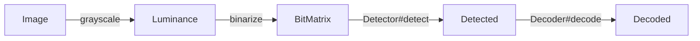

<div align="center">

# QRCode

A pure JavaScript QRCode encode and decode library.

<!-- prettier-ignore -->
> [![NPM Version][npm-image]][npm-url]
> [![Download Status][download-image]][npm-url]
> [![Languages Status][languages-image]][github-url]
> [![Zread][zread-image]][zread-url]
>
> [![Tree Shakeable][tree-shakeable-image]][bundle-phobia-url]
> [![Side Effect][side-effect-image]][bundle-phobia-url]
> [![Minzip][bundle-phobia-minzip]][bundle-phobia-url]
> [![License][license-image]][license-url]

**[English](./README.md)** | [简体中文](./README.zh-CN.md)

</div>

---

## Table of Contents

- [QRCode](#qrcode)
  - [Table of Contents](#table-of-contents)
  - [Features](#features)
  - [Installation](#installation)
  - [Quick Start](#quick-start)
  - [Encoding Guide](#encoding-guide)
    - [Error Correction Level](#error-correction-level)
    - [Segments and Modes](#segments-and-modes)
    - [Version](#version)
    - [Charsets and ECI](#charsets-and-eci)
    - [FNC1](#fnc1)
    - [Output](#output)
  - [Decoding Guide](#decoding-guide)
    - [Pipeline](#pipeline)
    - [Detection](#detection)
    - [Decoding](#decoding)
  - [API Reference](#api-reference) - [Common Interface](#common-interface) - [Encoder Interface](#encoder-interface) - [Decoder Interface](#decoder-interface)
  - [Links](#links)

## Features

- Pure JavaScript, zero native dependencies, runs in browsers and Node.js.
- Tree shakeable, side effect free, only bundle what you actually use.
- All QR code versions (1 - 40) and all error correction levels (L / M / Q / H).
- Mixed multi-segment encoding: `Numeric`, `Alphanumeric`, `Byte`, `Kanji` and `Hanzi`.
- ECI (Extended Channel Interpretation) and FNC1 (GS1 / AIM) support.
- Structured append and mirror detection on the decode side.
- Built-in GIF encoder, `toDataURL` works without canvas.
- Robust detection: perspective correction, timing line verification and mirror recovery.

## Installation

```sh
npm install @nuintun/qrcode
```

```ts
// ESM
import { Encoder } from '@nuintun/qrcode';

// CommonJS
const { Encoder } = require('@nuintun/qrcode');
```

## Quick Start

Encode a QR code and get a GIF data URL in three lines:

```ts
import { Encoder } from '@nuintun/qrcode';

const encoder = new Encoder({ level: 'H' });
const qrcode = encoder.encode(new Byte('https://github.com/nuintun/qrcode'));

console.log(qrcode.toDataURL());
```

Decode a QR code from an image:

```ts
import { binarize, Decoder, Detector, grayscale } from '@nuintun/qrcode';

// 1. Draw the image to a canvas and get its pixel data.
const imageData = context.getImageData(0, 0, width, height);

// 2. Convert to luminance and binarize to a black/white matrix.
const binarized = binarize(grayscale(imageData), width, height);

// 3. Detect QR code regions and decode each candidate.
const detector = new Detector();

for (const detect of detector.detect(binarized)) {
  // See [Decoding Guide](#decoding-guide) for the full pattern.
  const decoded = new Decoder().decode(detect.matrix);

  console.log(decoded.content);
}
```

The guides below explain each step in detail.

## Encoding Guide

The encoder turns one or more **segments** into a matrix. Each segment declares its own
optimised mode, and the encoder packs them into a single symbol, automatically
selecting the smallest version that fits (or the version you fixed), choosing the best
mask, and appending Reed-Solomon error correction codewords.

### Error Correction Level

Error correction allows a damaged QR code to be read. Higher level means more
redundancy, but also a larger symbol for the same data. Choose by scenario:

| Level | Recoverable Codewords | Recommended Scenario                                              |
| ----- | --------------------- | ----------------------------------------------------------------- |
| `L`   | ~7%                   | Clean environments, maximum data capacity                         |
| `M`   | ~15%                  | Common default, good balance                                      |
| `Q`   | ~25%                  | Outdoor, industrial, slightly dirty environments                  |
| `H`   | ~30%                  | Heavy damage or logo overlay, required for WeChat style centering |

```ts
const encoder = new Encoder({ level: 'H' });
```

### Segments and Modes

A segment is a piece of content encoded in its most efficient mode. Modes differ in
how many bits per character they cost:

| Segment        | Mode         | Bits per Character | Allowed Characters                                      |
| -------------- | ------------ | ------------------ | ------------------------------------------------------- |
| `Numeric`      | Numeric      | ~3.33              | Digits `0-9`                                            |
| `Alphanumeric` | Alphanumeric | 5.5                | Digits, `A-Z`, space and `$%*+-./:`                     |
| `Byte`         | Byte         | 8                  | Any text, encoded with a [`Charset`](#charsets-and-eci) |
| `Kanji`        | Kanji        | 13                 | Shift-JIS double byte characters (Japanese)             |
| `Hanzi`        | Hanzi        | 13                 | GB2312 double byte characters (Chinese)                 |

Segments are joined in a single `encode` call and the decoder restores them in order:

```ts
import { Byte, Encoder, Hanzi, Kanji } from '@nuintun/qrcode';

const encoder = new Encoder({ level: 'H' });

const qrcode = encoder.encode(
  // Hanzi
  new Hanzi('你好世界'),
  // Byte
  new Byte('\nhello world\n'),
  // Kanji
  new Kanji('こんにちは世界')
);
```

Use the most specific mode for each part: `new Numeric('1234567890')` costs far less
than `new Byte('1234567890')`.

### Version

A version is the symbol size, from 1 (21 x 21 modules) to 40 (177 x 177 modules).
By default the encoder picks the smallest version that fits your data:

```ts
const encoder = new Encoder({ version: 'Auto' }); // default
```

You can also fix a version, useful when a scanner expects a specific symbol size.
The encoder throws `data too big for requested version` if your data does not fit:

```ts
const encoder = new Encoder({ version: 5 });
```

### Charsets and ECI

A `Charset` identifies how `Byte` segment bytes should be interpreted by the scanner.
When you use a charset other than `ISO_8859_1` (the default), the encoder automatically
appends an **ECI segment** so the scanner knows how to decode the bytes.

The built-in encode function only supports `ASCII`, `ISO_8859_1` and `UTF_8`. For other
charsets, pass a custom `encode` function. In Node.js you can use `iconv-lite`:

```ts
import iconv from 'iconv-lite';
import { Byte, Charset, Encoder } from '@nuintun/qrcode';

const encoder = new Encoder({
  level: 'H',
  // Custom text encode function.
  encode: (content, charset) => iconv.encode(content, charset.label)
});

const qrcode = encoder.encode(new Byte('你好世界', Charset.GBK));
```

On the decode side, the built-in decode function uses the `TextDecoder` API, which covers
most browser supported labels. For charsets the platform does not support, pass a custom
`decode` function:

```ts
import iconv from 'iconv-lite';
import { Decoder } from '@nuintun/qrcode';

const decoder = new Decoder({
  // Custom text decode function.
  decode: (bytes, charset) => iconv.decode(Buffer.from(bytes), charset.label)
});
```

### FNC1

FNC1 marks a symbol as a GS1 or AIM application identifier, which changes how the
scanned content should be parsed. Enable it through `hints`, it is appended once,
before the first segment:

```ts
const encoder = new Encoder({
  level: 'H',
  hints: {
    // GS1 application identifiers.
    fnc1: ['GS1']
    // Or AIM with an indicator byte:
    // fnc1: ['AIM', 0x41]
  }
});
```

The decode side reports it back via `decoded.fnc1`.

### Output

`Encoder#encode` returns an `Encoded` object:

| Property / Method | Description                                           |
| ----------------- | ----------------------------------------------------- |
| `size`            | Symbol size in modules (21 - 177)                     |
| `version`         | Version number (1 - 40)                               |
| `level`           | Error correction level (`L` / `M` / `Q` / `H`)        |
| `mask`            | Mask pattern index (0 - 7)                            |
| `get(x, y)`       | Module value at coordinate, `0` (light) or `1` (dark) |
| `toDataURL(...)`  | Render to a GIF data URL, see parameters below        |

`toDataURL` uses the built-in GIF encoder, so it works everywhere, no canvas or DOM
required. Output size is `size * moduleSize + margin * 2` pixels (the margin is in
pixels, not modules):

| Parameter    | Type        | Default           | Description                  |
| ------------ | ----------- | ----------------- | ---------------------------- |
| `moduleSize` | `number`    | `2`               | Pixels per module, minimum 1 |
| `margin`     | `number`    | `moduleSize * 4`  | Quiet zone in pixels         |
| `foreground` | `[R, G, B]` | `[0, 0, 0]`       | Dark module color, 0 - 255   |
| `background` | `[R, G, B]` | `[255, 255, 255]` | Light module color, 0 - 255  |

```ts
qrcode.toDataURL(4, { margin: 16, foreground: [0, 102, 204], background: [255, 255, 255] });
```

For full control (SVG, canvas, styled modules), iterate the matrix yourself with
`size` and `get(x, y)`.

## Decoding Guide

### Pipeline

Decoding is a four step pipeline. The first two steps prepare the image, the third
finds candidate QR code regions, and the fourth extracts content:



Steps 1 and 2 are pure functions exported from the package, they accept any
`ImageData`-like object (in Node.js, any object with `data`, `width` and `height`).

### Detection

`Detector#detect` is a generator that yields every QR code region it finds as a
`Detected` object. A region is only a candidate, it may fail to decode, so the
generator asks you to report success back through `next(succeed)`:

```ts
import { binarize, Decoder, Detector, grayscale } from '@nuintun/qrcode';

const image = new Image();

image.crossOrigin = 'anonymous';

image.addEventListener('load', () => {
  const { width, height } = image;
  const canvas = new OffscreenCanvas(width, height);
  const context = canvas.getContext('2d')!;

  context.drawImage(image, 0, 0);

  const luminances = grayscale(context.getImageData(0, 0, width, height));
  const binarized = binarize(luminances, width, height);
  const detector = new Detector();
  const detected = detector.detect(binarized);
  const decoder = new Decoder();

  let current = detected.next();

  while (!current.done) {
    let succeed = false;

    try {
      const decoded = decoder.decode(current.value.matrix);

      console.log(decoded.content);

      succeed = true;
    } catch {
      // Decode failed, skipping...
    }

    // Notice: pass succeed to next() is very important,
    // this can significantly reduce the number of detections.
    current = detected.next(succeed);
  }
});

image.src = 'https://nuintun.github.io/qrcode/public/images/qrcode.jpg';
```

A `Detected` object describes where the QR code sits in the original image:

| Property / Method | Description                                                       |
| ----------------- | ----------------------------------------------------------------- |
| `matrix`          | The perspective corrected symbol matrix, pass it to the `Decoder` |
| `size`            | Symbol size in modules                                            |
| `moduleSize`      | Estimated module size in image pixels                             |
| `finder`          | Three finder patterns: `topLeft`, `topRight`, `bottomLeft`        |
| `alignment`       | Alignment pattern (undefined for versions without it)             |
| `mapping(x, y)`   | Maps symbol coordinates to image coordinates                      |

Use `mapping` to overlay highlights on the image, for example the four outer corners
and the timing patterns:

```ts
const detect = current.value;
const { size, finder, alignment } = detect;
const { topLeft, topRight, bottomLeft } = finder;
// Corners
const topLeftCorner = detect.mapping(0, 0);
const topRightCorner = detect.mapping(size, 0);
const bottomRightCorner = detect.mapping(size, size);
const bottomLeftCorner = detect.mapping(0, size);
// Timing
const topLeftTiming = detect.mapping(6.5, 6.5);
const topRightTiming = detect.mapping(size - 6.5, 6.5);
const bottomLeftTiming = detect.mapping(6.5, size - 6.5);
```

The `Detector` accepts one option, `strict`, which tightens finder pattern ratio
checking. Leave it off for tolerant scanning, enable it to reject marginal candidates:

```ts
const detector = new Detector({ strict: true });
```

### Decoding

`Decoder#decode` takes a `Detected` matrix (or any `BitMatrix` you built yourself) and
returns a `Decoded` object. It retries automatically in mirror mode when the symbol
does not parse, and reports that through `mirror`:

| Property     | Description                                                         |
| ------------ | ------------------------------------------------------------------- |
| `content`    | Decoded text content                                                |
| `version`    | Version number (1 - 40)                                             |
| `level`      | Error correction level (`L` / `M` / `Q` / `H`)                      |
| `mask`       | Mask pattern index (0 - 7)                                          |
| `mirror`     | Whether the symbol was decoded mirrored                             |
| `corrected`  | Number of error corrected codewords, a hint of image quality        |
| `symbology`  | AIM symbology identifier, `]Q` + modifier                           |
| `fnc1`       | `['GS1']` or `['AIM', indicator]` if present, otherwise `false`     |
| `structured` | `{ index, count, parity }` for structured append, otherwise `false` |
| `codewords`  | Raw data codewords, for advanced processing                         |

Structured append spreads one logical message across several symbols. Collect
`structured` results across images and join them by `index` and `count`:

```ts
if (decoded.structured) {
  const { index, count, parity } = decoded.structured;

  console.log(`part ${index + 1} of ${count}`);
}
```

## API Reference

##### Common Interface

```ts
declare type Level = 'L' | 'M' | 'Q' | 'H';

export class Charset {
  public static readonly CP437: Charset;
  public static readonly ISO_8859_1: Charset;
  public static readonly ISO_8859_2: Charset;
  public static readonly ISO_8859_3: Charset;
  public static readonly ISO_8859_4: Charset;
  public static readonly ISO_8859_5: Charset;
  public static readonly ISO_8859_6: Charset;
  public static readonly ISO_8859_7: Charset;
  public static readonly ISO_8859_8: Charset;
  public static readonly ISO_8859_9: Charset;
  public static readonly ISO_8859_10: Charset;
  public static readonly ISO_8859_11: Charset;
  public static readonly ISO_8859_13: Charset;
  public static readonly ISO_8859_14: Charset;
  public static readonly ISO_8859_15: Charset;
  public static readonly ISO_8859_16: Charset;
  public static readonly SHIFT_JIS: Charset;
  public static readonly CP1250: Charset;
  public static readonly CP1251: Charset;
  public static readonly CP1252: Charset;
  public static readonly CP1256: Charset;
  public static readonly UTF_16BE: Charset;
  public static readonly UTF_8: Charset;
  public static readonly ASCII: Charset;
  public static readonly BIG5: Charset;
  public static readonly GB2312: Charset;
  public static readonly EUC_KR: Charset;
  public static readonly GBK: Charset;
  public static readonly GB18030: Charset;
  public static readonly UTF_16LE: Charset;
  public static readonly UTF_32BE: Charset;
  public static readonly UTF_32LE: Charset;
  public static readonly ISO_646_INV: Charset;
  public static readonly BINARY: Charset;
  public constructor(label: string, ...values: number[]);
  public get label(): string;
  public get values(): readonly number[];
}

declare type FNC1 = readonly [mode: 'GS1'] | readonly [mode: 'AIM', indicator: number];
```

##### Encoder Interface

```ts
export class Numeric {
  public constructor(content: string);
}

export class Alphanumeric {
  public constructor(content: string);
}

export class Byte {
  public constructor(content: string, charset?: Charset);
}

export class Hanzi {
  public constructor(content: string);
}

export class Kanji {
  public constructor(content: string);
}

export interface EncoderOptions {
  level?: Level;
  hints?: { fnc1?: FNC1 };
  version?: 'Auto' | number;
  encode?: (content: string, charset: Charset) => Uint8Array;
}

declare interface DataURLOptions {
  margin?: number;
  foreground?: [R: number, G: number, B: number];
  background?: [R: number, G: number, B: number];
}

export class Encoded {
  public get size(): number;
  public get mask(): number;
  public get level(): Level;
  public get version(): number;
  public get(x: number, y: number): 0 | 1;
  public toDataURL(moduleSize?: number, options?: DataURLOptions): string;
}

export class Encoder {
  public constructor(options?: EncoderOptions);
  public encode(...segments: (Alphanumeric | Byte | Hanzi | Kanji | Numeric)[]): Encoded;
}
```

##### Decoder Interface

```ts
export class BitMatrix {
  public constructor(width: number, height: number, bits?: Int32Array);
  public get width(): number;
  public get height(): number;
  public set(x: number, y: number): void;
  public get(x: number, y: number): 0 | 1;
  public flip(): void;
  public flip(x: number, y: number): void;
  public clone(): BitMatrix;
  public setRegion(left: number, top: number, width: number, height: number): void;
}

export class Point {
  public get x(): number;
  public get y(): number;
}

export class Pattern extends Point {
  public get moduleSize(): number;
}

declare class FinderPatternGroup {
  public get topLeft(): Pattern;
  public get topRight(): Pattern;
  public get bottomLeft(): Pattern;
}

export class Detected {
  public get matrix(): BitMatrix;
  public get finder(): FinderPatternGroup;
  public get alignment(): Pattern | undefined;
  public get size(): number;
  public get moduleSize(): number;
  public mapping(x: number, y: number): Point;
}

declare interface Structured {
  readonly index: number;
  readonly count: number;
  readonly parity: number;
}

export class Decoded {
  public get mask(): number;
  public get level(): Level;
  public get version(): number;
  public get mirror(): boolean;
  public get content(): string;
  public get corrected(): number;
  public get symbology(): string;
  public get fnc1(): FNC1 | false;
  public get codewords(): Uint8Array;
  public get structured(): Structured | false;
}

export function grayscale(imageData: ImageData): Uint8Array;

export function binarize(luminances: Uint8Array, width: number, height: number): BitMatrix;

export interface DetectorOptions {
  strict?: boolean;
}

export class Detector {
  public constructor(options?: DetectorOptions);
  public detect(binarized: BitMatrix): Generator<Detected, void, boolean>;
}

export interface DecoderOptions {
  decode?: (bytes: Uint8Array, charset: Charset) => string;
}

export class Decoder {
  public constructor(options?: DecoderOptions);
  public decode(matrix: BitMatrix): Decoded;
}
```

## Links

<!-- prettier-ignore -->
> [zxing/zxing](https://github.com/zxing/zxing)
>
> [zxing-cpp/zxing-cpp](https://github.com/zxing-cpp/zxing-cpp)

[npm-image]: https://img.shields.io/npm/v/@nuintun/qrcode?style=flat-square
[npm-url]: https://www.npmjs.org/package/@nuintun/qrcode
[download-image]: https://img.shields.io/npm/dm/@nuintun/qrcode?style=flat-square
[languages-image]: https://img.shields.io/github/languages/top/nuintun/qrcode?style=flat-square
[github-url]: https://github.com/nuintun/qrcode
[zread-image]: https://img.shields.io/badge/Ask_Zread-_.svg?style=flat&color=00b0aa&labelColor=000000&logo=data%3Aimage%2Fsvg%2Bxml%3Bbase64%2CPHN2ZyB3aWR0aD0iMTYiIGhlaWdodD0iMTYiIHZpZXdCb3g9IjAgMCAxNiAxNiIgZmlsbD0ibm9uZSIgeG1sbnM9Imh0dHA6Ly93d3cudzMub3JnLzIwMDAvc3ZnIj4KPHBhdGggZD0iTTQuOTYxNTYgMS42MDAxSDIuMjQxNTZDMS44ODgxIDEuNjAwMSAxLjYwMTU2IDEuODg2NjQgMS42MDE1NiAyLjI0MDFWNC45NjAxQzEuNjAxNTYgNS4zMTM1NiAxLjg4ODEgNS42MDAxIDIuMjQxNTYgNS42MDAxSDQuOTYxNTZDNS4zMTUwMiA1LjYwMDEgNS42MDE1NiA1LjMxMzU2IDUuNjAxNTYgNC45NjAxVjIuMjQwMUM1LjYwMTU2IDEuODg2NjQgNS4zMTUwMiAxLjYwMDEgNC45NjE1NiAxLjYwMDFaIiBmaWxsPSIjZmZmIi8%2BCjxwYXRoIGQ9Ik00Ljk2MTU2IDEwLjM5OTlIMi4yNDE1NkMxLjg4ODEgMTAuMzk5OSAxLjYwMTU2IDEwLjY4NjQgMS42MDE1NiAxMS4wMzk5VjEzLjc1OTlDMS42MDE1NiAxNC4xMTM0IDEuODg4MSAxNC4zOTk5IDIuMjQxNTYgMTQuMzk5OUg0Ljk2MTU2QzUuMzE1MDIgMTQuMzk5OSA1LjYwMTU2IDE0LjExMzQgNS42MDE1NiAxMy43NTk5VjExLjAzOTlDNS42MDE1NiAxMC42ODY0IDUuMzE1MDIgMTAuMzk5OSA0Ljk2MTU2IDEwLjM5OTlaIiBmaWxsPSIjZmZmIi8%2BCjxwYXRoIGQ9Ik0xMy43NTg0IDEuNjAwMUgxMS4wMzg0QzEwLjY4NSAxLjYwMDEgMTAuMzk4NCAxLjg4NjY0IDEwLjM5ODQgMi4yNDAxVjQuOTYwMUMxMC4zOTg0IDUuMzEzNTYgMTAuNjg1IDUuNjAwMSAxMS4wMzg0IDUuNjAwMUgxMy43NTg0QzE0LjExMTkgNS42MDAxIDE0LjM5ODQgNS4zMTM1NiAxNC4zOTg0IDQuOTYwMVYyLjI0MDFDMTQuMzk4NCAxLjg4NjY0IDE0LjExMTkgMS42MDAxIDEzLjc1ODQgMS42MDAxWiIgZmlsbD0iI2ZmZiIvPgo8cGF0aCBkPSJNNCAxMkwxMiA0TDQgMTJaIiBmaWxsPSIjZmZmIi8%2BCjxwYXRoIGQ9Ik00IDEyTDEyIDQiIHN0cm9rZT0iI2ZmZiIgc3Ryb2tlLXdpZHRoPSIxLjUiIHN0cm9rZS1saW5lY2FwPSJyb3VuZCIvPgo8L3N2Zz4K&logoColor=ffffff
[zread-url]: https://zread.ai/nuintun/qrcode
[tree-shakeable-image]: https://img.shields.io/badge/tree--shakeable-true-brightgreen?style=flat-square
[side-effect-image]: https://img.shields.io/badge/side--effect-free-brightgreen?style=flat-square
[bundle-phobia-url]: https://bundlephobia.com/result?p=@nuintun/qrcode
[bundle-phobia-minzip]: https://img.shields.io/bundlephobia/minzip/%40nuintun/qrcode/latest?style=flat-square
[license-image]: https://img.shields.io/github/license/nuintun/qrcode?style=flat-square
[license-url]: https://github.com/nuintun/qrcode/blob/main/packages/core/LICENSE
