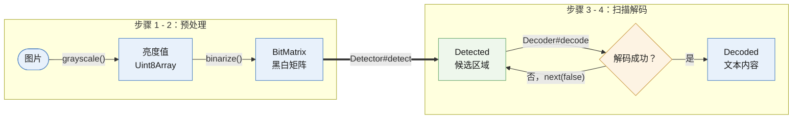

<div align="center">

# QRCode

一个纯 JavaScript 的二维码编码与解码库。

<!-- prettier-ignore -->
> [![NPM Version][npm-image]][npm-url]
> [![Download Status][download-image]][npm-url]
> [![Languages Status][languages-image]][github-url]
> [![Zread][zread-image]][zread-url]
>
> [![Tree Shakeable][tree-shakeable-image]][bundle-phobia-url]
> [![Side Effect][side-effect-image]][bundle-phobia-url]
> [![Minzip][bundle-phobia-minzip]][bundle-phobia-url]
> [![License][license-image]][license-url]

[English](./README.md) | **[简体中文](./README.zh-CN.md)**

</div>

---

## 目录

- [特性](#特性)
- [安装](#安装)
- [快速上手](#快速上手)
- [编码指南](#编码指南)
  - [纠错等级](#纠错等级)
  - [数据段与模式](#数据段与模式)
  - [版本](#版本)
  - [字符集与 ECI](#字符集与-eci)
  - [FNC1](#fnc1)
  - [输出](#输出)
- [解码指南](#解码指南)
  - [处理流程](#处理流程)
  - [定位检测](#定位检测)
  - [内容解码](#内容解码)
- [API 参考](#api-参考)
  - [通用接口](#通用接口)
  - [编码器接口](#编码器接口)
  - [解码器接口](#解码器接口)
- [相关链接](#相关链接)

## 特性

- 纯 JavaScript 实现，零原生依赖，浏览器和 Node.js 均可运行。
- 支持 Tree shaking，无副作用，用多少打包多少。
- 支持全部二维码版本（1 - 40）和全部纠错等级（L / M / Q / H）。
- 多段混合编码：`Numeric`（数字）、`Alphanumeric`（字母数字）、`Byte`（字节）、`Kanji`（日文汉字）和 `Hanzi`（中文汉字）。
- 支持 ECI（扩展字符集解释）和 FNC1（GS1 / AIM）模式。
- 解码端支持结构化追加与镜像检测。
- 内置 GIF 编码器，`toDataURL` 无需 canvas。
- 定位健壮：透视变换校正、时序线校验与镜像恢复。

## 安装

```sh
npm install @nuintun/qrcode
```

```ts
// ESM
import { Encoder } from '@nuintun/qrcode';

// CommonJS
const { Encoder } = require('@nuintun/qrcode');
```

## 快速上手

三行代码生成二维码的 GIF Data URL：

```ts
import { Encoder } from '@nuintun/qrcode';

const encoder = new Encoder({ level: 'H' });
const qrcode = encoder.encode(new Byte('https://github.com/nuintun/qrcode'));

console.log(qrcode.toDataURL());
```

从图片中解码二维码：

```ts
import { binarize, Decoder, Detector, grayscale } from '@nuintun/qrcode';

// 1. 把图片画到 canvas 上，取出像素数据。
const imageData = context.getImageData(0, 0, width, height);

// 2. 转为亮度值，再二值化成黑白矩阵。
const binarized = binarize(grayscale(imageData), width, height);

// 3. 检测二维码区域，逐个候选解码。
const detector = new Detector();

for (const detect of detector.detect(binarized)) {
  // 完整写法见 [解码指南](#解码指南)。
  const decoded = new Decoder().decode(detect.matrix);

  console.log(decoded.content);
}
```

下面的指南会详细讲解每一步。

## 编码指南

编码器把一个或多个**数据段（Segment）**打包成一个矩阵。每个数据段声明自己的最优模式，
编码器将它们组合进同一个符号：自动选择能装下的最小版本（或你指定的版本）、挑选最优掩模、
追加 Reed-Solomon 纠错码字。

### 纠错等级

纠错能力让破损的二维码依然可以被读取。等级越高冗余越多，同样数据所需的符号也越大。按场景选择：

| 等级 | 可恢复码字 | 推荐场景                                  |
| ---- | ---------- | ----------------------------------------- |
| `L`  | 约 7%      | 干净环境，追求最大数据容量                |
| `M`  | 约 15%     | 通用默认值，容量与稳健性均衡              |
| `Q`  | 约 25%     | 户外、工业、较脏环境                      |
| `H`  | 约 30%     | 严重破损或中心加 Logo（微信样式必须用 H） |

```ts
const encoder = new Encoder({ level: 'H' });
```

### 数据段与模式

数据段是一段按其最高效模式编码的内容。不同模式每个字符消耗的位数不同：

| 数据段         | 模式         | 每字符位数 | 允许的字符                                       |
| -------------- | ------------ | ---------- | ------------------------------------------------ |
| `Numeric`      | 数字模式     | 约 3.33    | 数字 `0-9`                                       |
| `Alphanumeric` | 字母数字模式 | 5.5        | 数字、`A-Z`、空格和 `$%*+-./:`                   |
| `Byte`         | 字节模式     | 8          | 任意文本，按指定 [`Charset`](#字符集与-eci) 编码 |
| `Kanji`        | 日文汉字模式 | 13         | Shift-JIS 双字节字符（日文）                     |
| `Hanzi`        | 中文汉字模式 | 13         | GB2312 双字节字符（中文）                        |

在同一次 `encode` 调用中传入多个数据段，解码时会按原始顺序还原：

```ts
import { Byte, Encoder, Hanzi, Kanji } from '@nuintun/qrcode';

const encoder = new Encoder({ level: 'H' });

const qrcode = encoder.encode(
  // 中文汉字
  new Hanzi('你好世界'),
  // 字节
  new Byte('\nhello world\n'),
  // 日文汉字
  new Kanji('こんにちは世界')
);
```

每一段都用最具体的模式：`new Numeric('1234567890')` 的开销远小于 `new Byte('1234567890')`。

### 版本

版本决定符号尺寸，从版本 1（21 x 21 模块）到版本 40（177 x 177 模块）。
默认情况下编码器自动选择能装下数据的最小版本：

```ts
const encoder = new Encoder({ version: 'Auto' }); // 默认值
```

也可以固定版本，适用于扫码设备要求特定符号尺寸的场景。数据装不下时，
编码器会抛出 `data too big for requested version`：

```ts
const encoder = new Encoder({ version: 5 });
```

### 字符集与 ECI

`Charset` 标识 `Byte` 数据段的字节应如何被扫码端解释。使用非 `ISO_8859_1`（默认值）
的字符集时，编码器会自动追加一个 **ECI 数据段**，告知扫码端如何解码这些字节。

内置编码函数仅支持 `ASCII`、`ISO_8859_1` 和 `UTF_8`。其他字符集需要传入自定义
`encode` 函数，Node.js 中可以使用 `iconv-lite`：

```ts
import iconv from 'iconv-lite';
import { Byte, Charset, Encoder } from '@nuintun/qrcode';

const encoder = new Encoder({
  level: 'H',
  // 自定义文本编码函数。
  encode: (content, charset) => iconv.encode(content, charset.label)
});

const qrcode = encoder.encode(new Byte('你好世界', Charset.GBK));
```

解码端内置的解码函数使用 `TextDecoder` API，覆盖平台支持的大部分标签。
平台不支持的字符集，可传入自定义 `decode` 函数：

```ts
import iconv from 'iconv-lite';
import { Decoder } from '@nuintun/qrcode';

const decoder = new Decoder({
  // 自定义文本解码函数。
  decode: (bytes, charset) => iconv.decode(Buffer.from(bytes), charset.label)
});
```

### FNC1

FNC1 将符号标记为 GS1 或 AIM 应用标识符，决定扫码内容应如何解析。通过 `hints` 开启，
它只会在第一个数据段之前追加一次：

```ts
const encoder = new Encoder({
  level: 'H',
  hints: {
    // GS1 应用标识符。
    fnc1: ['GS1']
    // 或携带指示字节的 AIM：
    // fnc1: ['AIM', 0x41]
  }
});
```

解码端通过 `decoded.fnc1` 返回该信息。

### 输出

`Encoder#encode` 返回一个 `Encoded` 对象：

| 属性 / 方法      | 说明                                    |
| ---------------- | --------------------------------------- |
| `size`           | 符号尺寸（模块数，21 - 177）            |
| `version`        | 版本号（1 - 40）                        |
| `level`          | 纠错等级（`L` / `M` / `Q` / `H`）       |
| `mask`           | 掩模图案索引（0 - 7）                   |
| `get(x, y)`      | 指定坐标的模块值，`0`（浅）或 `1`（深） |
| `toDataURL(...)` | 渲染为 GIF Data URL，参数见下表         |

`toDataURL` 使用内置 GIF 编码器，任何环境都可用，无需 canvas 或 DOM。
输出尺寸为 `size * moduleSize + margin * 2` 像素（margin 单位是像素而非模块）：

| 参数         | 类型        | 默认值            | 说明                       |
| ------------ | ----------- | ----------------- | -------------------------- |
| `moduleSize` | `number`    | `2`               | 每个模块的像素数，最小为 1 |
| `margin`     | `number`    | `moduleSize * 4`  | 静区（留白）像素数         |
| `foreground` | `[R, G, B]` | `[0, 0, 0]`       | 深色模块颜色，0 - 255      |
| `background` | `[R, G, B]` | `[255, 255, 255]` | 浅色模块颜色，0 - 255      |

```ts
qrcode.toDataURL(4, { margin: 16, foreground: [0, 102, 204], background: [255, 255, 255] });
```

如需完全控制（SVG、canvas、自定义模块样式），可用 `size` 和 `get(x, y)` 自行遍历矩阵。

## 解码指南

### 处理流程

解码是四步流水线：前两步预处理图像，第三步找出候选二维码区域，第四步提取内容。
解码失败的候选会回到检测器继续尝试，直到候选耗尽：



前两步都是包内导出的纯函数，接受任何 `ImageData` 风格的对象
（Node.js 中任何包含 `data`、`width` 和 `height` 属性的对象均可）。

### 定位检测

`Detector#detect` 是一个生成器，把找到的每个二维码区域作为 `Detected` 对象逐个产出。
区域只是候选结果，不一定能解码成功，因此生成器要求你通过 `next(succeed)` 反馈是否成功：

```ts
import { binarize, Decoder, Detector, grayscale } from '@nuintun/qrcode';

const image = new Image();

image.crossOrigin = 'anonymous';

image.addEventListener('load', () => {
  const { width, height } = image;
  const canvas = new OffscreenCanvas(width, height);
  const context = canvas.getContext('2d')!;

  context.drawImage(image, 0, 0);

  const luminances = grayscale(context.getImageData(0, 0, width, height));
  const binarized = binarize(luminances, width, height);
  const detector = new Detector();
  const detected = detector.detect(binarized);
  const decoder = new Decoder();

  let current = detected.next();

  while (!current.done) {
    let succeed = false;

    try {
      const decoded = decoder.decode(current.value.matrix);

      console.log(decoded.content);

      succeed = true;
    } catch {
      // 解码失败，跳过...
    }

    // 注意：将 succeed 传递给 next() 非常重要，
    // 这样可以显著减少重复检测的次数。
    current = detected.next(succeed);
  }
});

image.src = 'https://nuintun.github.io/qrcode/public/images/qrcode.jpg';
```

`Detected` 对象描述二维码在原图中的位置信息：

| 属性 / 方法     | 说明                                              |
| --------------- | ------------------------------------------------- |
| `matrix`        | 透视校正后的符号矩阵，传给 `Decoder` 解码         |
| `size`          | 符号尺寸（模块数）                                |
| `moduleSize`    | 估算的模块像素尺寸                                |
| `finder`        | 三个定位图案：`topLeft`、`topRight`、`bottomLeft` |
| `alignment`     | 校正图形（无校正图形的版本为 undefined）          |
| `mapping(x, y)` | 将符号坐标映射到图片坐标                          |

用 `mapping` 可以在原图上叠加高亮，例如四个外角和时序图形：

```ts
const detect = current.value;
const { size, finder, alignment } = detect;
const { topLeft, topRight, bottomLeft } = finder;
// 四个角
const topLeftCorner = detect.mapping(0, 0);
const topRightCorner = detect.mapping(size, 0);
const bottomRightCorner = detect.mapping(size, size);
const bottomLeftCorner = detect.mapping(0, size);
// 时序图形
const topLeftTiming = detect.mapping(6.5, 6.5);
const topRightTiming = detect.mapping(size - 6.5, 6.5);
const bottomLeftTiming = detect.mapping(6.5, size - 6.5);
```

`Detector` 只有一个选项 `strict`，用于收紧定位图案比例校验。宽松扫描时不要开启，
需要拒绝边缘候选结果时再启用：

```ts
const detector = new Detector({ strict: true });
```

### 内容解码

`Decoder#decode` 接收 `Detected` 采样后的矩阵（或任何自建的 `BitMatrix`），返回
`Decoded` 对象。解析失败时会自动以镜像模式重试，并通过 `mirror` 报告：

| 属性         | 说明                                                     |
| ------------ | -------------------------------------------------------- |
| `content`    | 解码出的文本内容                                         |
| `version`    | 版本号（1 - 40）                                         |
| `level`      | 纠错等级（`L` / `M` / `Q` / `H`）                        |
| `mask`       | 掩模图案索引（0 - 7）                                    |
| `mirror`     | 符号是否以镜像方式解码                                   |
| `corrected`  | 纠错修复的码字数量，可作为图像质量的参考                 |
| `symbology`  | AIM 符号标识符，`]Q` + 修饰符                            |
| `fnc1`       | 存在时为 `['GS1']` 或 `['AIM', indicator]`，否则 `false` |
| `structured` | 结构化追加时为 `{ index, count, parity }`，否则 `false`  |
| `codewords`  | 原始数据码字，用于高级处理                               |

结构化追加会把一条逻辑消息拆分到多个符号中。收集多次扫描的 `structured` 结果，
按 `index` 和 `count` 拼接即可：

```ts
if (decoded.structured) {
  const { index, count, parity } = decoded.structured;

  console.log(`第 ${index + 1} / ${count} 部分`);
}
```

## API 参考

##### 通用接口

```ts
declare type Level = 'L' | 'M' | 'Q' | 'H';

export class Charset {
  public static readonly CP437: Charset;
  public static readonly ISO_8859_1: Charset;
  public static readonly ISO_8859_2: Charset;
  public static readonly ISO_8859_3: Charset;
  public static readonly ISO_8859_4: Charset;
  public static readonly ISO_8859_5: Charset;
  public static readonly ISO_8859_6: Charset;
  public static readonly ISO_8859_7: Charset;
  public static readonly ISO_8859_8: Charset;
  public static readonly ISO_8859_9: Charset;
  public static readonly ISO_8859_10: Charset;
  public static readonly ISO_8859_11: Charset;
  public static readonly ISO_8859_13: Charset;
  public static readonly ISO_8859_14: Charset;
  public static readonly ISO_8859_15: Charset;
  public static readonly ISO_8859_16: Charset;
  public static readonly SHIFT_JIS: Charset;
  public static readonly CP1250: Charset;
  public static readonly CP1251: Charset;
  public static readonly CP1252: Charset;
  public static readonly CP1256: Charset;
  public static readonly UTF_16BE: Charset;
  public static readonly UTF_8: Charset;
  public static readonly ASCII: Charset;
  public static readonly BIG5: Charset;
  public static readonly GB2312: Charset;
  public static readonly EUC_KR: Charset;
  public static readonly GBK: Charset;
  public static readonly GB18030: Charset;
  public static readonly UTF_16LE: Charset;
  public static readonly UTF_32BE: Charset;
  public static readonly UTF_32LE: Charset;
  public static readonly ISO_646_INV: Charset;
  public static readonly BINARY: Charset;
  public constructor(label: string, ...values: number[]);
  public get label(): string;
  public get values(): readonly number[];
}

export type FNC1 = readonly [mode: 'GS1'] | readonly [mode: 'AIM', indicator: number];
```

##### 编码器接口

```ts
export class Numeric {
  public constructor(content: string);
}

export class Alphanumeric {
  public constructor(content: string);
}

export class Byte {
  public constructor(content: string, charset?: Charset);
}

export class Hanzi {
  public constructor(content: string);
}

export class Kanji {
  public constructor(content: string);
}

export interface EncoderOptions {
  level?: Level;
  hints?: { fnc1?: FNC1 };
  version?: 'Auto' | number;
  encode?: (content: string, charset: Charset) => Uint8Array;
}

declare interface DataURLOptions {
  margin?: number;
  foreground?: [R: number, G: number, B: number];
  background?: [R: number, G: number, B: number];
}

export class Encoded {
  public get size(): number;
  public get mask(): number;
  public get level(): Level;
  public get version(): number;
  public get(x: number, y: number): 0 | 1;
  public toDataURL(moduleSize?: number, options?: DataURLOptions): string;
}

export class Encoder {
  public constructor(options?: EncoderOptions);
  public encode(...segments: (Alphanumeric | Byte | Hanzi | Kanji | Numeric)[]): Encoded;
}
```

##### 解码器接口

```ts
export class BitMatrix {
  public constructor(width: number, height: number, bits?: Int32Array);
  public get width(): number;
  public get height(): number;
  public set(x: number, y: number): void;
  public get(x: number, y: number): 0 | 1;
  public flip(): void;
  public flip(x: number, y: number): void;
  public clone(): BitMatrix;
  public setRegion(left: number, top: number, width: number, height: number): void;
}

export class Point {
  public get x(): number;
  public get y(): number;
}

export class Pattern extends Point {
  public get moduleSize(): number;
}

export class FinderPatternGroup {
  public get topLeft(): Pattern;
  public get topRight(): Pattern;
  public get bottomLeft(): Pattern;
}

export class Detected {
  public get matrix(): BitMatrix;
  public get finder(): FinderPatternGroup;
  public get alignment(): Pattern | undefined;
  public get size(): number;
  public get moduleSize(): number;
  public mapping(x: number, y: number): Point;
}

export interface Structured {
  readonly index: number;
  readonly count: number;
  readonly parity: number;
}

export class Decoded {
  public get mask(): number;
  public get level(): Level;
  public get version(): number;
  public get mirror(): boolean;
  public get content(): string;
  public get corrected(): number;
  public get symbology(): string;
  public get fnc1(): FNC1 | false;
  public get codewords(): Uint8Array;
  public get structured(): Structured | false;
}

export function grayscale(imageData: ImageData): Uint8Array;

export function binarize(luminances: Uint8Array, width: number, height: number): BitMatrix;

export interface DetectorOptions {
  strict?: boolean;
}

export class Detector {
  public constructor(options?: DetectorOptions);
  public detect(binarized: BitMatrix): Generator<Detected, void, boolean>;
}

export interface DecoderOptions {
  decode?: (bytes: Uint8Array, charset: Charset) => string;
}

export class Decoder {
  public constructor(options?: DecoderOptions);
  public decode(matrix: BitMatrix): Decoded;
}
```

## 相关链接

<!-- prettier-ignore -->
> [zxing/zxing](https://github.com/zxing/zxing)
>
> [zxing-cpp/zxing-cpp](https://github.com/zxing-cpp/zxing-cpp)

[npm-image]: https://img.shields.io/npm/v/@nuintun/qrcode?style=flat-square
[npm-url]: https://www.npmjs.org/package/@nuintun/qrcode
[download-image]: https://img.shields.io/npm/dm/@nuintun/qrcode?style=flat-square
[languages-image]: https://img.shields.io/github/languages/top/nuintun/qrcode?style=flat-square
[github-url]: https://github.com/nuintun/qrcode
[zread-image]: https://img.shields.io/badge/Ask_Zread-_.svg?style=flat&color=00b0aa&labelColor=000000&logo=data%3Aimage%2Fsvg%2Bxml%3Bbase64%2CPHN2ZyB3aWR0aD0iMTYiIGhlaWdodD0iMTYiIHZpZXdCb3g9IjAgMCAxNiAxNiIgZmlsbD0ibm9uZSIgeG1sbnM9Imh0dHA6Ly93d3cudzMub3JnLzIwMDAvc3ZnIj4KPHBhdGggZD0iTTQuOTYxNTYgMS42MDAxSDIuMjQxNTZDMS44ODgxIDEuNjAwMSAxLjYwMTU2IDEuODg2NjQgMS42MDE1NiAyLjI0MDFWNC45NjAxQzEuNjAxNTYgNS4zMTM1NiAxLjg4ODEgNS42MDAxIDIuMjQxNTYgNS42MDAxSDQuOTYxNTZDNS4zMTUwMiA1LjYwMDEgNS42MDE1NiA1LjMxMzU2IDUuNjAxNTYgNC45NjAxVjIuMjQwMUM1LjYwMTU2IDEuODg2NjQgNS4zMTUwMiAxLjYwMDEgNC45NjE1NiAxLjYwMDFaIiBmaWxsPSIjZmZmIi8%2BCjxwYXRoIGQ9Ik00Ljk2MTU2IDEwLjM5OTlIMi4yNDE1NkMxLjg4ODEgMTAuMzk5OSAxLjYwMTU2IDEwLjY4NjQgMS42MDE1NiAxMS4wMzk5VjEzLjc1OTlDMS42MDE1NiAxNC4xMTM0IDEuODg4MSAxNC4zOTk5IDIuMjQxNTYgMTQuMzk5OUg0Ljk2MTU2QzUuMzE1MDIgMTQuMzk5OSA1LjYwMTU2IDE0LjExMzQgNS42MDE1NiAxMy43NTk5VjExLjAzOTlDNS42MDE1NiAxMC42ODY0IDUuMzE1MDIgMTAuMzk5OSA0Ljk2MTU2IDEwLjM5OTlaIiBmaWxsPSIjZmZmIi8%2BCjxwYXRoIGQ9Ik0xMy43NTg0IDEuNjAwMUgxMS4wMzg0QzEwLjY4NSAxLjYwMDEgMTAuMzk4NCAxLjg4NjY0IDEwLjM5ODQgMi4yNDAxVjQuOTYwMUMxMC4zOTg0IDUuMzEzNTYgMTAuNjg1IDUuNjAwMSAxMS4wMzg0IDUuNjAwMUgxMy43NTg0QzE0LjExMTkgNS42MDAxIDE0LjM5ODQgNS4zMTM1NiAxNC4zOTg0IDQuOTYwMVYyLjI0MDFDMTQuMzk4NCAxLjg4NjY0IDE0LjExMTkgMS42MDAxIDEzLjc1ODQgMS42MDAxWiIgZmlsbD0iI2ZmZiIvPgo8cGF0aCBkPSJNNCAxMkwxMiA0TDQgMTJaIiBmaWxsPSIjZmZmIi8%2BCjxwYXRoIGQ9Ik00IDEyTDEyIDQiIHN0cm9rZT0iI2ZmZiIgc3Ryb2tlLXdpZHRoPSIxLjUiIHN0cm9rZS1saW5lY2FwPSJyb3VuZCIvPgo8L3N2Zz4K&logoColor=ffffff
[zread-url]: https://zread.ai/nuintun/qrcode
[tree-shakeable-image]: https://img.shields.io/badge/tree--shakeable-true-brightgreen?style=flat-square
[side-effect-image]: https://img.shields.io/badge/side--effect-free-brightgreen?style=flat-square
[bundle-phobia-url]: https://bundlephobia.com/result?p=@nuintun/qrcode
[bundle-phobia-minzip]: https://img.shields.io/bundlephobia/minzip/%40nuintun/qrcode/latest?style=flat-square
[license-image]: https://img.shields.io/github/license/nuintun/qrcode?style=flat-square
[license-url]: https://github.com/nuintun/qrcode/blob/main/packages/core/LICENSE
